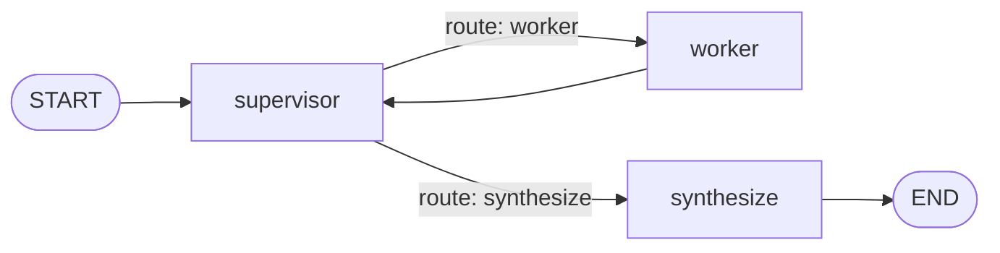

# IMPLEMENTATION — ManualChat

This document describes what ManualChat implements: the tech stack, the
architecture, the HTTP API, the data contracts, the on-disk layout, and the
frontend. It is a technical reference, not a plan. The task numbers (Task 1 to
Task 6) name the milestone that built each part.

`PROGRESS.md` holds the current state and what is left. `DECISIONS.md` holds the
ratified decisions and their config keys. `SPECIFICATION.md` holds the
requirements. `README.md` holds the environment variable table.

---

## 1. Tech stack

| Layer | Component | Notes |
|---|---|---|
| Language and runtime | Python 3.11+ with a UV virtual environment | Backend runs bare-metal or in Docker. |
| PDF extraction | IBM Docling | `do_ocr=False`, FAST table structure, one batch item, two threads. |
| PDF slicing and raster | PyMuPDF | Cuts the page slices and renders the PNG thumbnails. |
| Vector store | Qdrant | One collection. Embedded local mode by default, with no server or credentials. |
| Embeddings | `sentence-transformers` | `multi-qa-mpnet-base-dot-v1` for the first pass. |
| Reranking | `sentence-transformers` | `cross-encoder/ms-marco-MiniLM-L-6-v2` for the second pass. |
| Chunk token counting | tiktoken | The `cl100k_base` encoding. |
| Agent orchestration | LangGraph `StateGraph` | A supervisor, worker, and synthesize topology. |
| LLM gateway | OpenRouter | `backend/llm.py` is the only module that calls OpenRouter. The selected model picks a tier (DECISIONS M1). |
| Evaluations | `backend/eval/` | An LLM judge scores the 16-question accuracy set. |
| Monitoring | LangSmith | `backend/tracing.py` traces each OpenRouter call when enabled. |
| API backend | FastAPI | Background ingest, Server-Sent Events, and file responses. |
| Frontend | Next.js 14 App Router, Tailwind CSS v4, assistant-ui, react-pdf | Chat, citations, and the manual viewer. |

`project_proposal.md` records the tech options that were rejected.

---

## 2. Architecture and data flow

### 2.1 System topology

```
                    ┌───────────────────────────────────────────┐
                    │            Next.js frontend               │
                    │  chat, citations, manual viewer (browser)  │
                    └───────┬───────────────────────▲───────────┘
                            │                       │
              JSON / SSE API calls         PDF slices, whole PDF,
                            │                PNG thumbnails
                    ┌───────▼───────────────────────┴───────────┐
                    │              FastAPI backend              │
                    │           (backend/api/main.py)           │
                    └───┬───────────┬───────────────┬───────────┘
                        │           │               │
              ┌─────────▼──┐  ┌─────▼──────┐  ┌─────▼──────────────┐
              │ LangGraph  │  │  Manual    │  │  retrieval.py      │
              │ agent      │  │  storage   │  │  chunk, embed,     │
              │ supervisor │  │  (disk)    │  │  rerank, search    │
              └─────┬──────┘  └────────────┘  └─────┬──────────────┘
                    │                               │
            ┌───────▼───────┐             ┌─────────▼─────────┐
            │  OpenRouter   │             │  Qdrant (local)   │
            │  LLM / tools  │             │  on-disk store    │
            └───────────────┘             └───────────────────┘
```

A browser session keeps one active vehicle. Every chat request carries its
`vehicle_id`, and retrieval uses that value to scope the search.

### 2.2 Ingestion pipeline (Task 1)

`backend/ingest.py` turns a stored `source.pdf` into the text and tables that
later stages chunk and index.

```
source.pdf
  │
  ├─► Text-layer probe                  (PyMuPDF)
  │     └─► average characters per page
  │           below threshold  -> status = error, stop  (DECISIONS D1)
  │
  ├─► Hidden-OCR sanitize               (PyMuPDF)
  │     └─► remove ghost-font spans that do not overlap visible text (D2)
  │
  ├─► Docling convert                   (do_ocr=False, FAST tables, batch 1)
  │     └─► per-page progress events -> manual.progress
  │
  ├─► Normalize                         (unit and header repair, D3)
  │
  └─► Persist under manuals/{manual_id}/
        ├─► page_text/page_NNNN.txt     one file per physical page
        ├─► tables.json                 each table as Markdown, with its page
        ├─► ingest.json                 the IngestResult summary
        └─► status = ready, page_count set
```

On upload, the API schedules `ingest_in_background`. After the pipeline reaches
`ready`, that function chunks and indexes the manual through
`retrieval.index_manual` and writes `chunk_count`. A failure sets
`status = error`. The same pipeline runs by hand with
`python -m backend.ingest <manual_id>`.

The run reports its position on the manual's `progress` field. Conversion
reports one event per converted page. Indexing reports one event per embedded
batch. The upload dialog reads that field and shows a bar with a time estimate.

### 2.3 Agent graph and tool loop (Task 4)

`backend/agent/graph.py` builds the graph and compiles it at import. The shape
is a supervisor, worker, and synthesize topology.



The `supervisor` node reads the question and what the worker has found, then
decides whether the worker keeps searching or the graph synthesizes. A hop cap
(`AGENT_MAX_HOPS`) forces synthesis when the supervisor has not stopped. The
`worker` node runs the tool loop over the calculator and the three RAG tools. A
second cap (`AGENT_MAX_TOOL_STEPS`) bounds that loop. The `synthesize` node
writes the final markdown answer with `[Page N]` citations.

The model the user picked selects a tier (DECISIONS M1). The tier fixes two
models: a working model that runs the supervisor routing check and the worker's
tool loop, and an authoring model that writes the answer. The expensive model
is spent only on the answer.

The graph state is `AgentState`: `messages` (merged with `add_messages`),
`model` (a per-request override), `vehicle_id`, `stream`, `gathered`, `next`,
and `hops`. The `worker` node appends its findings to `gathered` so the
supervisor sees them; `next` is the supervisor's routing decision; `hops`
counts the worker runs. When `stream` is true, the `synthesize` node streams
content deltas through the stream writer and the `worker` node streams a
`tool_call` event before each tool runs and a `tool_result` event after.
`POST /chat/stream` consumes those events.

The `worker` node merges the state's `vehicle_id` into every tool argument
whose executor takes that parameter, and it overrides any value the model
supplied. The model cannot know the vehicle id, so the state value is the only
trusted source.

The tools live in `backend/tools.py`.

| Tool | Arguments | Returns |
|---|---|---|
| `calculator` | `expression` | The numeric result, or an error string. |
| `search_manual` | `query`, `vehicle_id`, `manual_id?`, `top_k?` | `SearchResult` JSON: reranked chunks with page citations. |
| `extract_specs` | `subject`, `vehicle_id`, `manual_id?` | `ExtractSpecsResult` JSON: verbatim table rows that match the subject. |
| `get_page_text` | `page_numbers`, `manual_id`, `vehicle_id?` | `GetPageTextResult` JSON: the full text of each requested page. |

`search_manual` calls `retrieval.search`. `extract_specs` reads `tables.json`
and matches the subject against table captions and row labels. It skips
disabled manuals and returns each matched row verbatim. `get_page_text` reads
`page_text/page_NNNN.txt` for each requested physical page.

---

## 3. HTTP API (Task 5)

`backend/api/main.py` holds every endpoint. CORS allows the Next.js dev server
on `localhost:3000`.

| Method | Path | Purpose | Response |
|---|---|---|---|
| GET | `/health` | Liveness check. | `{"status": "ok"}` |
| GET | `/models` | The model selector choices. | `{"default": ..., "options": [...]}` |
| POST | `/chat` | Run one chat turn through the graph. | `{"reply": ..., "model": ...}` |
| POST | `/chat/stream` | The same turn as Server-Sent Events. | SSE stream |
| POST | `/manuals` | Store an uploaded PDF and start ingest. | A `Manual` with `status="processing"` |
| GET | `/manuals` | List every stored manual, newest first. | `Manual[]` |
| GET | `/manuals/{id}` | One manual, including its ingest progress. | `Manual` |
| PATCH | `/manuals/{id}` | Enable or disable a manual. | `Manual` |
| DELETE | `/manuals/{id}` | Purge a manual's index, then remove it. | `{"deleted": "<id>"}` |
| GET | `/manuals/{id}/pages/{start}-{end}` | A PDF holding those pages, both ends inclusive. | `application/pdf` |
| GET | `/manuals/{id}/pdf` | The whole stored PDF. | `application/pdf` |
| GET | `/manuals/{id}/thumbnails/{page}` | One page as a PNG. | `image/png` |
| GET | `/vehicles` | List every vehicle profile, newest first. | `Vehicle[]` |
| POST | `/vehicles` | Create a vehicle profile. | `Vehicle` |
| PATCH | `/vehicles/{id}` | Rename a vehicle profile. | `Vehicle` |
| DELETE | `/vehicles/{id}` | Delete a vehicle profile. | `{"deleted": "<id>"}` |

`POST /chat` and `POST /chat/stream` take a `ChatRequest`:
`{"query": str, "model": str | null, "vehicle_id": str | null}`. The `model`
field overrides the config default for that request. The `vehicle_id` field
scopes the turn to one vehicle.

Status codes:

- `400` for an empty `vehicle_id` or `display_name`, a non-PDF upload, a bad
  page range, a bad page number, and an LLM failure on `POST /chat`.
- `404` for an unknown manual or vehicle, and for a manual whose `source.pdf`
  is missing.
- `409` for an upload whose SHA-256 digest matches an existing manual of the
  same vehicle. The body names the manual it duplicates.
- `304` for a page request whose `If-None-Match` matches the slice `ETag`.

`POST /chat/stream` sends one JSON object per `data:` line. Content arrives as
`{"type": "token", "content": "..."}`. Tool activity arrives as
`{"type": "tool_call", "tool_call_id": ..., "tool_name": ..., "args_text": ...}`
before a tool runs and
`{"type": "tool_result", "tool_call_id": ..., "result": ..., "error": ...}`
after it finishes. The stream ends with
`{"type": "done", "content": "<full reply>", "model": "<slug>"}`. A failure
before any answer ends the stream with `{"type": "error", "message": "..."}`.

`DELETE /manuals/{id}` purges the indexed chunks first, then removes the record
and its directory. The purge runs first so a failure there leaves the record in
place to retry.

---

## 4. Data contracts and storage

### 4.1 Data schemas (backend/schemas.py)

These are the output contracts of the tools and the storage records. The input
contracts (the OpenAI function-calling schemas the model sees) live in
`backend/tools.py`.

```python
class Vehicle(BaseModel):
    vehicle_id: str
    user_id: str = "default_user"
    display_name: str
    created_at: datetime

class IngestProgress(BaseModel):
    stage: Literal["probe", "convert", "index", "done"] = "probe"
    completed: int = 0
    total: int = 0

class Manual(BaseModel):
    manual_id: str
    vehicle_id: str
    display_name: str
    source_filename: str
    description: Optional[str] = None
    content_hash: Optional[str] = None      # SHA-256 of the uploaded bytes
    status: Literal["processing", "ready", "error"] = "processing"
    enabled: bool = True                    # gates retrieval only
    page_count: int = 0
    chunk_count: int = 0
    progress: IngestProgress
    created_at: datetime

class TextLayerProbe(BaseModel):
    page_count: int
    total_chars: int
    avg_chars_per_page: float
    threshold: float
    needs_ocr: bool

class IngestTable(BaseModel):
    page_number: int
    caption: Optional[str] = None
    markdown: str

class IngestResult(BaseModel):
    manual_id: str
    page_count: int
    table_count: int
    probe: TextLayerProbe
    normalized: bool
    hidden_ocr_detected: bool

class ChunkPayload(BaseModel):
    text: str
    vehicle_id: str
    manual_id: str
    page_number: int                        # physical PDF page, 1-indexed
    physical_page: Optional[int] = None     # legacy, unused
    section_name: Optional[str] = None
    is_table: bool = False
    score: float = 0.0

class SpecItem(BaseModel):
    item: str
    value: str
    unit: str
    page_number: int

class PageText(BaseModel):
    page_number: int
    text: str

class SearchResult(BaseModel):
    query: str
    results: list[ChunkPayload]

class ExtractSpecsResult(BaseModel):
    subject: str
    specs: list[SpecItem]

class GetPageTextResult(BaseModel):
    manual_id: str
    pages: list[PageText]
```

A disabled manual stays stored and listed, but its chunks never come back from
search. Citations carry the physical PDF page number. The printed page number
on the sheet stays unrecovered (DECISIONS D12).

### 4.2 On-disk layout

`backend/storage.py` writes one directory per record. Every id is a
server-generated UUID, so a client cannot address another record's directory.
The original filename lives only in the `source_filename` field.

```
{manuals_dir}/                     # MANUALS_DIR, default "manuals"
  {manual_id}/                     # a UUID
    source.pdf                     # the uploaded bytes, fixed name
    manual.json                    # the Manual record
    page_text/page_NNNN.txt        # written by ingest
    tables.json                    # written by ingest
    ingest.json                    # written by ingest

{vehicles_dir}/                    # VEHICLES_DIR, default "vehicles"
  {vehicle_id}/                    # a UUID
    vehicle.json                   # the Vehicle record

{qdrant_path}/                     # QDRANT_PATH, default "qdrant"
                                   # the embedded Qdrant store
```

A relative `manuals_dir`, `vehicles_dir`, or `qdrant_path` resolves against the
repo root, not the process working directory. Docker Compose bind-mounts
`manuals/`, `vehicles/`, and `qdrant/`, so uploads, profiles, and the index all
persist on the host.

A manual record is written through a temporary file and an atomic replace,
because ingest rewrites the record while it runs and a reader must never catch
a half-written file.

---

## 5. Retrieval (Task 3)

`backend/retrieval.py` chunks a manual's ingest output, embeds the chunks, and
stores them in Qdrant. Heavy imports (tiktoken, sentence-transformers,
qdrant-client) stay inside the functions that need them, so importing the
module is free.

Chunking follows the ratified values.

- Prose splits at section headings. A heading stays attached to the body it
  introduces.
- Prose chunks target `INGEST_CHUNK_TOKENS` (512) with
  `INGEST_CHUNK_OVERLAP_TOKENS` (64) of overlap.
- Each table stays one chunk, even when it exceeds the prose budget.
- Token counting uses `INGEST_TOKENIZER` (`cl100k_base`).

Embedding uses `RETRIEVAL_EMBED_MODEL` (`multi-qa-mpnet-base-dot-v1`) with
L2-normalized vectors, in batches of `RETRIEVAL_EMBED_BATCH_SIZE` (64).

The store is the `QDRANT_COLLECTION` collection (`manualchat_chunks`) with
cosine distance. An empty `QDRANT_URL` selects the embedded local store at
`QDRANT_PATH`. A point id is a UUIDv5 derived from `{manual_id}:chunk:{i}`, so
ids stay unique across the manuals in one collection. A re-index deletes the
manual's existing points first, so it never duplicates them.

A search runs in two stages:

1. Qdrant filters on `vehicle_id` and an optional `manual_id`, and excludes the
   manuals the vehicle has disabled. It returns `RETRIEVAL_CANDIDATE_K` (50)
   candidates.
2. The cross-encoder (`RETRIEVAL_RERANK_MODEL`) scores each candidate. A sigmoid
   maps the score to 0 to 1. The top `RETRIEVAL_TOP_N` (5) come back.

Deleting a manual purges its points through `delete_manual_index`. A missing
store or collection makes that call a no-op, so it never creates a store just
to delete from it.

---

## 6. Frontend (Task 6)

| File | Responsibility |
|---|---|
| `app/page.tsx` | The page that mounts the runtime providers. |
| `app/chat-runtime.tsx` | The assistant-ui chat adapter. Calls `POST /chat` scoped to the active vehicle. |
| `app/vehicle-runtime.tsx` | The active vehicle state. |
| `app/viewer-runtime.tsx` | The manual viewer pane state. |
| `app/theme-runtime.tsx` | The light and dark theme state. |
| `lib/api.ts` | A typed client that wraps every backend call. |
| `lib/pdf-cache.ts` | The slice and whole-manual byte caches. |
| `lib/ingest-progress.ts` | The upload progress bar and its time estimate. |
| `lib/viewer-config.ts` | The `NEXT_PUBLIC_VIEWER_*` values. |
| `components/manual-upload.tsx` | The upload dialog. |
| `components/manual-viewer.tsx` | The viewer pane and its react-pdf document. |
| `components/vehicle-selector.tsx` | The vehicle dropdown in the top bar. |
| `components/vehicle-picker.tsx` | The vehicle picker inside the upload dialog. |
| `components/top-bar.tsx` | The bar that holds the selector, upload, viewer, model, and theme controls. |
| `components/theme-toggle.tsx` | The theme switch. |
| `components/assistant-ui/elements/markdown-text.tsx` | Renders each `[Page N]` as a clickable badge. |

A click on a page badge opens the viewer beside the chat at the cited page. The
pane shows the cited page plus the configured pages around it, with selectable
text and zoom. The pane opens at the cited page, so a page held before it
scrolls out of view. While a slice shows, the pane names it in place of the
manual selector. A `View whole manual` button opens the stored PDF, and the
pages mount one at a time as the reader scrolls.

The viewer caches PDF bytes, never rendered pages. Page slices live in a
module-level `Map` with an LRU cap. A whole manual is cached once per manual in
the Cache API. Deleting a manual drops its cached bytes. The page endpoints
answer with `Cache-Control: immutable` and an `ETag`, so a matching request
returns `304`. The slice `ETag` comes from the stored PDF and the page range,
because PyMuPDF stamps a fresh document id into every re-serialization.

Next.js inlines `NEXT_PUBLIC_` values at build time or at dev-server start, so
restart the frontend after a change to one.

---

## 7. Page thumbnails (raster fallback) (Task 5)

`GET /manuals/{id}/thumbnails/{page}` renders one physical page of the stored
`source.pdf` to a PNG with PyMuPDF. The resolution is the `THUMBNAIL_DPI` value
(150 by default). A client that cannot mount the PDF viewer uses this raster
fallback mode.

---

## 8. Configuration

Every tunable value lives in `backend/config.py` and is read from the
environment. There is no `.env` file in the repo. `README.md` holds the full
environment variable table with defaults.

The config groups are:

- Model selection and generation: `MODEL_DEFAULT`, `MODEL_OPTIONS`, the
  `MODEL_*` generation parameters, and the `SUPER_SUB_*` tier table.
- Agent graph: `AGENT_SYSTEM_PROMPT`, `AGENT_MAX_HOPS`, and
  `AGENT_MAX_TOOL_STEPS`.
- Local storage: `MANUALS_DIR`, `VEHICLES_DIR`.
- Manual viewer: `THUMBNAIL_DPI`, `VIEWER_CACHE_MAX_AGE_SECONDS`.
- Ingestion: the `INGEST_*` pipeline and chunking values.
- Retrieval: the `QDRANT_*` and `RETRIEVAL_*` values.
- Automated evals: the `EVAL_*` judge and gating values.
- Monitoring: the `LANGSMITH_*` tracing values.
